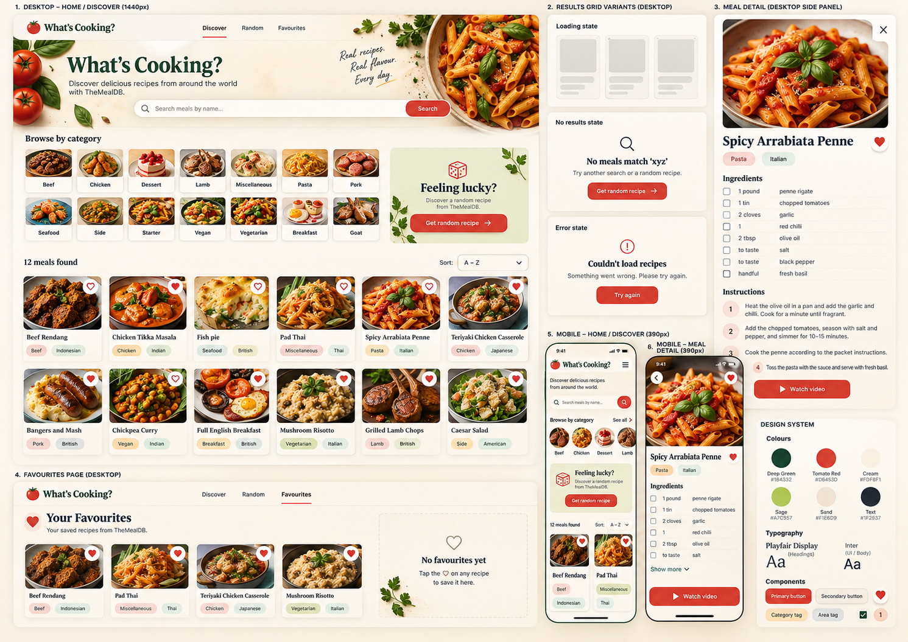
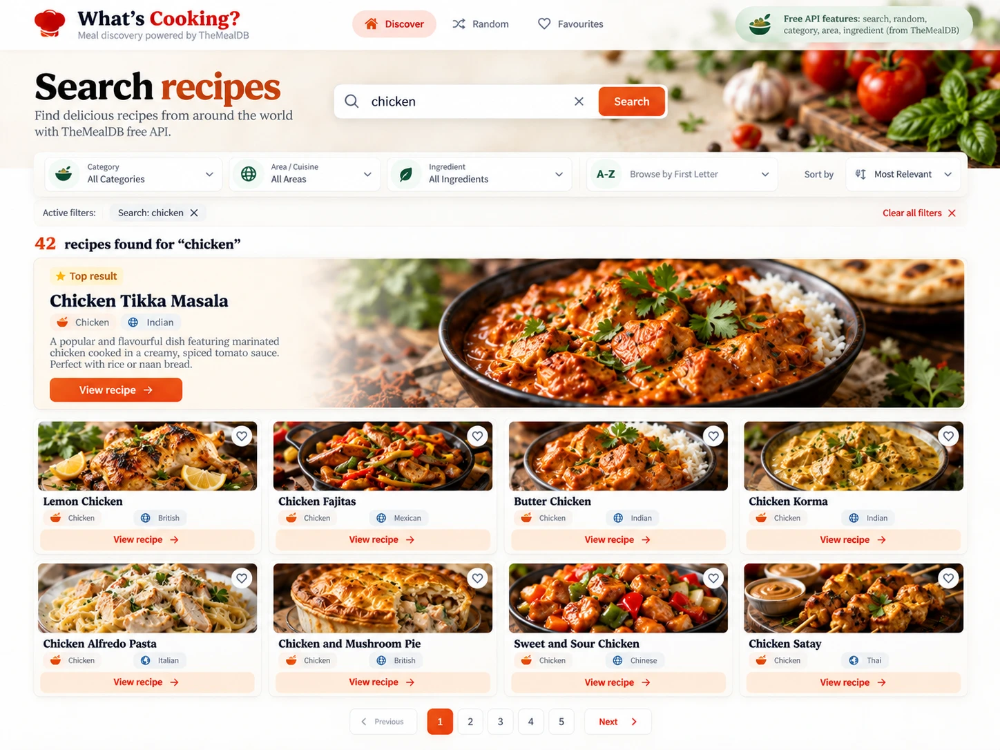
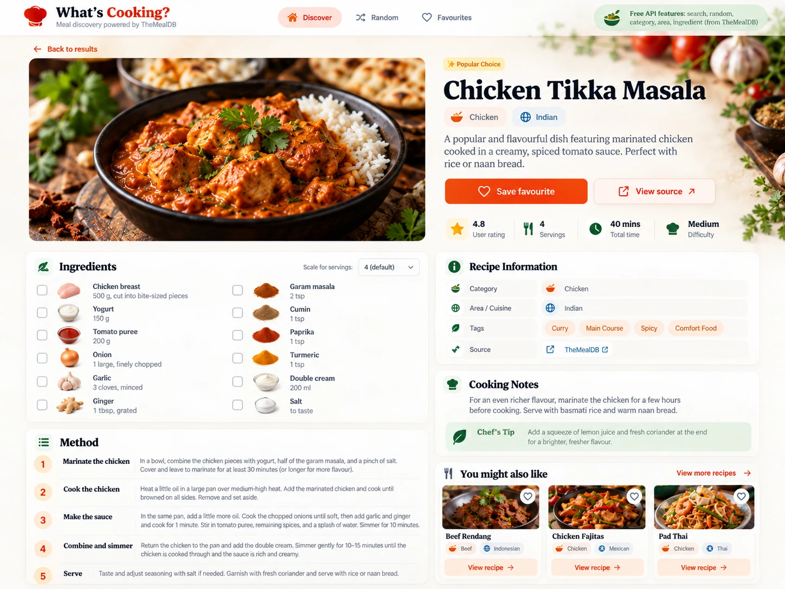

# Design mockups

## `original.png`: the main mockup (session 1)

The design everything is based on (2026-10-08), generated from a prompt that only uses what TheMealDB provides. It covers the home/discover page with **category cards**, results grid states (loading, no results, error), the favourites page, mobile views, and the design system (colours, fonts, components).

**Not used:** section 3 (meal detail side panel) and section 6 (mobile meal detail). Meal detail is a **routed page** (`/meal/:id`) based on `recipe.webp` instead (decided 2026-10-18).

## Later mockups

`search.webp` and `recipe.webp` were generated with GPT (2026-10-14) as targets for the **SearchBar + meal grid** and **MealDetail** steps on the roadmap. They follow the design system in `src/index.css`.

Some parts aren't in TheMealDB, so they're marked below as build, adapt or drop.

## `search.webp`: search page

| Part                                   | Verdict  | Notes                                                                                                                                                         |
| -------------------------------------- | -------- | ------------------------------------------------------------------------------------------------------------------------------------------------------------- |
| Search box                             | ✅ Build | `search.php?s=chicken`                                                                                                                                        |
| Category / Area / Ingredient dropdowns | ✅ Build | Options from `list.php?c=list`, `?a=list`, `?i=list`                                                                                                          |
| Browse by first letter                 | ✅ Build | `search.php?f=a`                                                                                                                                              |
| Meal cards (image, title, heart, tags) | ⚠️ Adapt | `filter.php` results have `idMeal`, `strMeal`, `strMealThumb`, `strArea` (sometimes `null`) and `strCountry`, but no category. Search results have everything |
| Combining filters (Chicken + Indian…)  | ⚠️ Adapt | The API filters by **one** thing at a time. Combining means fetching several lists and intersecting by `idMeal`                                               |
| "42 recipes found"                     | ✅ Build | `meals.length` (and the API returns `meals: null` for no results!)                                                                                            |
| Pagination                             | ✅ Build | The API returns everything at once, so we slice the array ourselves                                                                                           |
| Sort A–Z                               | ✅ Build | Version 2 on the roadmap                                                                                                                                      |
| "Most Relevant" sort / "Top result"    | ❌ Drop  | The API doesn't rank results. Could feature the first result instead                                                                                          |
| Top result description text            | ❌ Drop  | Meals have no description                                                                                                                                     |

## `recipe.webp`: recipe page

| Part                                     | Verdict  | Notes                                                                                             |
| ---------------------------------------- | -------- | ------------------------------------------------------------------------------------------------- |
| Photo, title, category + area tags       | ✅ Build | `lookup.php?i=<idMeal>`                                                                           |
| Save favourite                           | ✅ Build | Same favourites state as `FavouriteButton`                                                        |
| View source                              | ✅ Build | `strSource` (sometimes empty, so hide the button then)                                            |
| Ingredients with measures + checkboxes   | ✅ Build | `strIngredient1–20` + `strMeasure1–20` → transform into an array. `IngredientList` owns the ticks |
| Ingredient images                        | ✅ Build | `https://www.themealdb.com/images/ingredients/<Name>-Small.png`                                   |
| Tags                                     | ✅ Build | `strTags`, a comma-separated string (can be `null`)                                               |
| Method steps (numbered)                  | ⚠️ Adapt | `strInstructions` is one text blob. Split on line breaks into numbered steps; **no step titles**  |
| You might also like                      | ✅ Build | `filter.php?c=<category>`, excluding the current meal                                             |
| YouTube video                            | ➕ Add   | Not in the mockup, but `strYoutube` exists and the plan has a video button                        |
| Description text                         | ❌ Drop  | Not in the API                                                                                    |
| Rating, servings, total time, difficulty | ❌ Drop  | Not in the API                                                                                    |
| Cooking notes / Chef's tip               | ❌ Drop  | Not in the API                                                                                    |
| "Popular Choice" badge                   | ❌ Drop  | Not in the API                                                                                    |
| Scale for servings                       | ❌ Drop  | Measures are free text ("1 large", "to taste") so they can't be scaled reliably                   |
